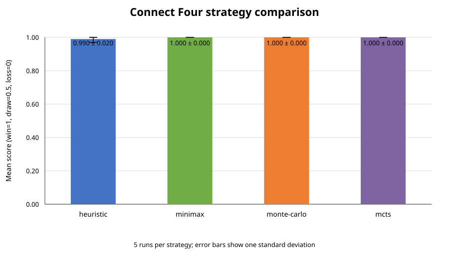
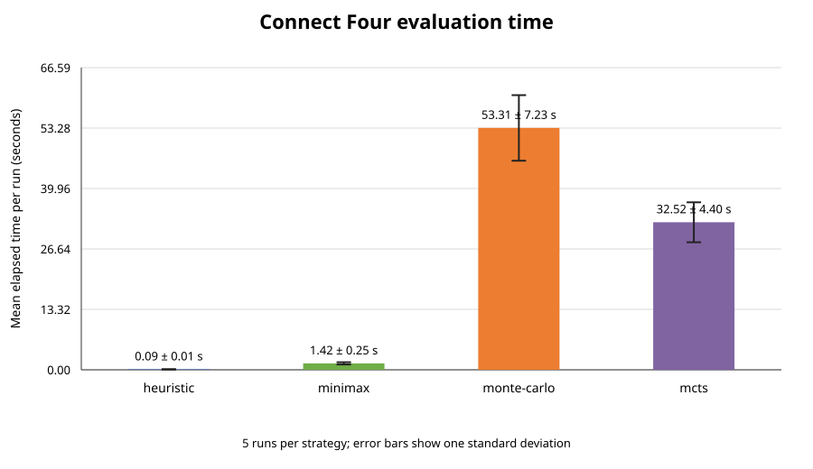

# Connect Four

This project studies how to design and optimize complete playing strategies for Connect Four. A candidate solution is a set of rules or parameters used to choose moves throughout a game, rather than a single move. Strategies will be evaluated against multiple opponents and from both starting positions.

## Problem analysis

Connect Four is a two-player, turn-based, perfect-information game played on a 6-row by 7-column board. On each turn, a player drops a token into a non-full column, where it occupies the lowest available cell. A player wins by connecting four tokens horizontally, vertically, or diagonally; a full board without a winner is a draw.

At a decision point, the strategy receives the board state, the player to move, and the legal moves. Whole-strategy evaluation also depends on the selected opponents, match rules, and experiment configuration. The main formulation is to find strategy parameters $\theta$ that maximize average match score:

$$
F(\theta) = \frac{1}{N}\sum_{i=1}^{N} r_i
$$

where each game result $r_i$ is 1 for a win, 0.5 for a draw, and 0 for a loss. Candidate evaluation uses a fixed opponent set and conditions; parameters should be tuned on training games and final results measured on a separate test set.

## Problem classification

- **Numerical, mixed-variable optimization:** heuristic weights are real-valued, while search depth and simulation budgets are integer-valued.
- **Combined and constrained:** the goal is to maximize strategy performance while respecting parameter domains, legal-move rules, and computational limits.
- **Single-objective:** average game score is the objective; computational cost is treated as a constraint in the primary formulation.
- **Deterministic or stochastic evaluation:** game rules and deterministic strategies such as Minimax are deterministic under fixed tie-breaking; Monte Carlo methods introduce randomness through simulations.
- **Static optimization:** the opponent set and evaluation conditions are fixed while optimizing a candidate, even though game states change during play.
- **Black-box with some grey-box information:** candidate quality is observed by playing games, while the game rules and heuristic features are known.

## Candidate strategy representations

The analysis considers several complete strategy designs:

- **Parameterized heuristic:** score legal moves with a weighted function, for example using immediate wins, blocking, center control, threats, and mobility; choose the highest-scoring move.
- **Minimax with alpha-beta pruning:** search to a configured depth and evaluate non-terminal leaf states with a heuristic.
- **Monte Carlo simulations:** estimate each move's value from simulated game continuations.
- **Monte Carlo Tree Search (MCTS):** allocate simulations selectively across a search tree, for example using UCB1.

The board can be represented as a 6×7 matrix containing empty cells and the two players' tokens; a bitboard is an alternative for more efficient operations. All strategies should share the same legal-move generation, move application, and game-end checks.

## Constraints and evaluation

Strategies must select a legal move whenever the game is ongoing, never play in a full column, and stop after a win or draw. Candidate parameters and each method's search or simulation budget must remain within defined bounds. Invalid moves should be recorded as errors or handled using a documented penalty or recovery rule, not silently accepted.

Experiments should use the same opponents, rules, and comparable computational budgets across methods. Each strategy should play as both the first and second player; stochastic methods should be tested with multiple random seeds. Report wins, draws, losses, average score, and relevant costs such as decision time, searched nodes, or simulations.

## Alternative formulations

Possible variants include discrete rather than continuous weights, rule-based strategies, multi-objective optimization of score and decision cost, strategies that adapt during play, and combinations of heuristic evaluation with search. These alternatives change the candidate representation, optimization space, or constraints and should be justified before implementation.

## Project contents

- `analysis.pdf` – detailed analysis of the problem and proposed experiment plan.
- `connect_four.py` – command-line runner and match evaluation.
- `connect_four_core.py` – board rules, legal moves, random baseline, and game loop.
- `heuristic_strategy.py` – weighted heuristic strategy.
- `minimax_strategy.py` – alpha-beta Minimax strategy.
- `monte_carlo_strategy.py` – random-rollout Monte Carlo strategy.
- `mcts_strategy.py` – UCT Monte Carlo tree search strategy.
- `run_experiments.py` – repeated strategy evaluation, result export, and SVG chart generation.
- `test_connect_four.py` – rule, constraint, strategy, and evaluation checks.
- `test_experiments.py` – experiment runner and report output checks.

## Model Implementation and Verification with a Baseline

The model uses a 6×7 board with `0` for an empty cell and `1` or `2` for a player's token. The shared game code validates boards and moves, lists non-full columns, drops tokens to the lowest empty cell, detects wins in all four directions, and ends games on a win or a full-board draw. Invalid moves raise an error instead of being accepted.

Each strategy represents a complete way to choose moves throughout a game:

- The **heuristic** takes an immediate win, blocks one immediate opponent win if possible, then ranks moves by weighted center control and open four-cell lines. Its `center` and `open_windows` weights are bounded from 0 to 1.
- **Minimax** searches to a configurable depth with alpha-beta pruning and uses a weighted board evaluation at non-terminal leaves.
- **Monte Carlo** evaluates possible moves with a fixed number of random complete-game rollouts.
- **MCTS** uses UCT to allocate a fixed iteration budget across a search tree, with random rollouts to estimate outcomes.
- The **baseline** selects uniformly at random from legal columns.

### Run the model and baseline

The project uses only the Python standard library. Run one strategy against the random baseline with:

```powershell
python connect_four.py --strategy heuristic --games-per-side 10 --seed 0
python connect_four.py --strategy minimax --depth 4 --games-per-side 10 --seed 0
python connect_four.py --strategy monte-carlo --simulations 100 --games-per-side 10 --seed 0
python connect_four.py --strategy mcts --iterations 500 --games-per-side 10 --seed 0
```

The evaluator tests each strategy in both board seats and alternates the
starting player. It reports wins, draws, losses, games, and mean score, where
win = 1, draw = 0.5, and loss = 0.

Run the verification tests with:

```powershell
python -m unittest -v
```

The tests cover board rules, legal-move constraints, immediate wins and blocks,
search budget validation, seeded reproducibility, both player positions, and
the experiment output files.

### Run repeated experiments and visualize results

Run the four strategies for multiple independent seeds against the random baseline:

```powershell
python run_experiments.py --runs 5 --games-per-side 10 --seed 0 --output-dir results
```

Select one or more strategies and adjust their budgets as needed:

```powershell
python run_experiments.py --strategies heuristic minimax --runs 5 --games-per-side 10 --depth 4
python run_experiments.py --strategies mcts --runs 5 --games-per-side 10 --iterations 500
```

Each run evaluates the candidate in both board seats and both starting orders.
The output directory contains:

- `strategy_results.csv` – per-run outcomes, seeds, parameters, and elapsed time.
- `strategy_summary.csv` – average scores, variability, outcomes, and runtime.
- `strategy_results.json` – full run data and experiment settings.
- `strategy_scores.svg` – mean score with one-standard-deviation error bars.
- `strategy_runtime.svg` – mean evaluation time with one-standard-deviation error bars.

### Initial results

The current sample used 3 runs per strategy, 4 games per board seat per run
(8 games per run), seed `41`, Minimax depth `3`, 10 Monte Carlo simulations per
move, and 25 MCTS iterations per move. Both heuristic weights were `0.5`.

| Strategy | Mean score | Score standard deviation | Mean wins / draws / losses per 8-game run | Mean run time |
|---|---:|---:|---:|---:|
| Heuristic | 0.958 | 0.059 | 7.67 / 0 / 0.33 | 0.067 s |
| Minimax | 0.958 | 0.059 | 7.67 / 0 / 0.33 | 0.357 s |
| Monte Carlo | 0.958 | 0.059 | 7.67 / 0 / 0.33 | 2.656 s |
| MCTS | 1.000 | 0.000 | 8 / 0 / 0 | 0.935 s |

These are preliminary smoke-test results, not enough to conclude that one
strategy is best. There are only three runs, the random baseline is weak, and
the methods' configured search budgets are not directly comparable. The charts
and raw results are saved in the `results` folder.

#### Mean score



#### Evaluation runtime



### Next goals

The next step is to build on this model for the first-results milestone:

1. Run more games and independent seeds for more stable comparisons.
2. Add stronger opponents, such as a tactical win/block baseline, because random play is easy to beat.
3. Use a justified common computational budget or time limit and compare both score and runtime.
4. Analyze results by player seat and starting order, and decide whether to tune budgets or improve a method.
